# Workflow flowcharts (actual implementation)

Diagrams follow source at `507cc02`. Grey / dashed nodes are **unverified**, **gated**, or **not implemented**. They are not drawn as if they already succeed in production.

## 1. Patient registration and routing

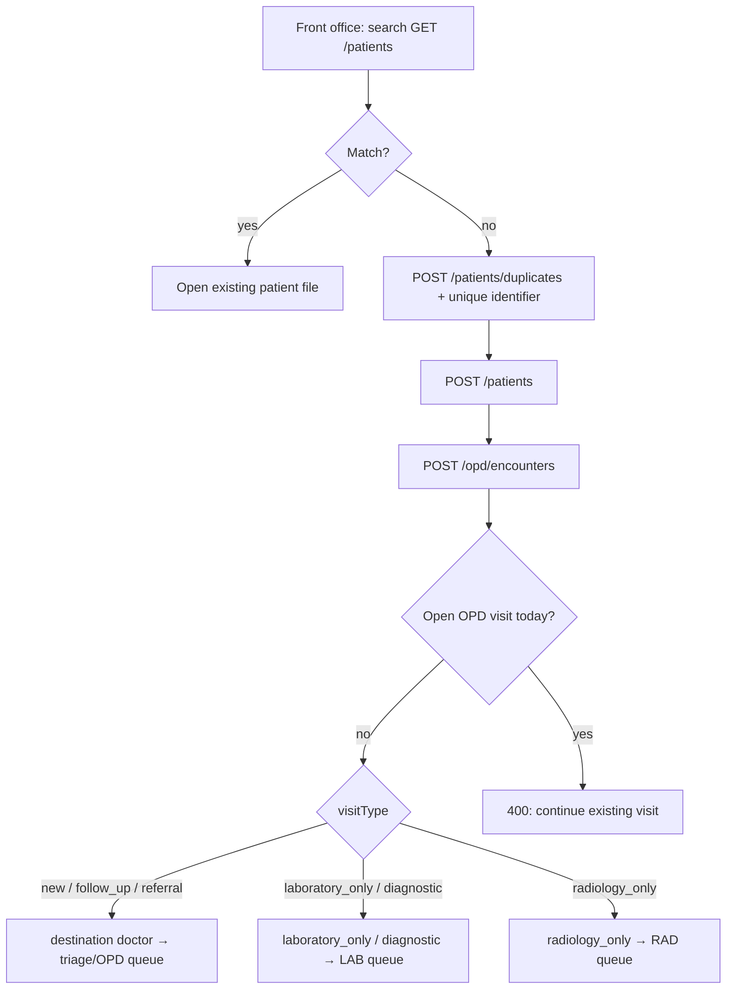

Check-in does **not** insert a consultation charge. Reception **displays** clinic `consultationFee`. Cashier may still post a consultation charge later (**unverified** whether staff always follow diagnostic-only policy).

## 2. OPD consultation and completion

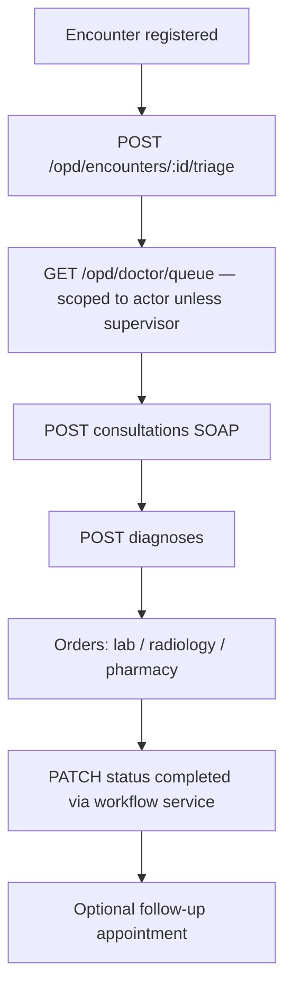

Invalid status transitions are rejected by `EncounterWorkflowService`.

## 3. Prescription → dispense → stock → charge

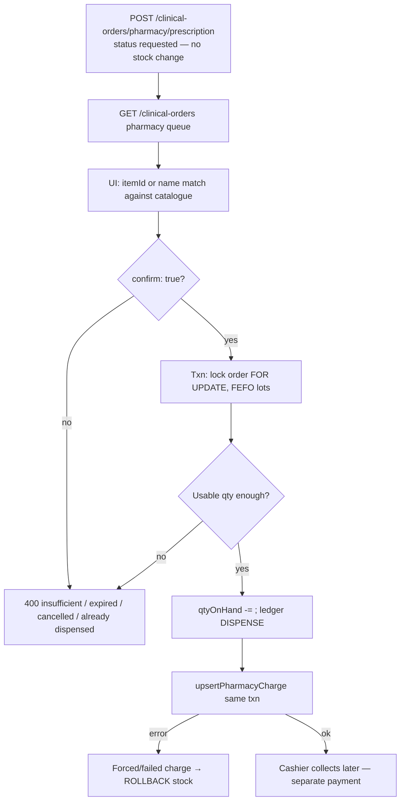

**Unverified in this audit:** live mismatch between Rx qty, ledger, and charge. **User-reported:** some dispensing problems (see `04-opd-and-pharmacy-assessment.md`).

## 4. Laboratory

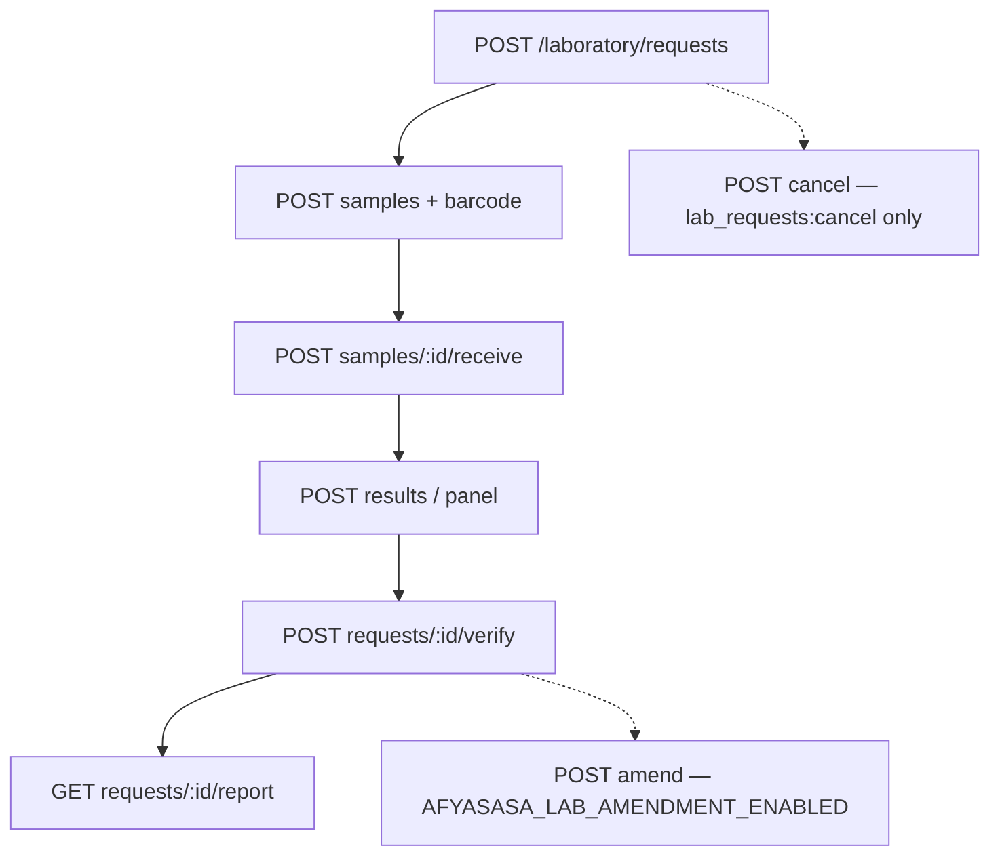

Amend is **blocked** while the compose flag is false. Template layouts exist; **clinical sign-off of layouts is outstanding**.

## 5. Radiology

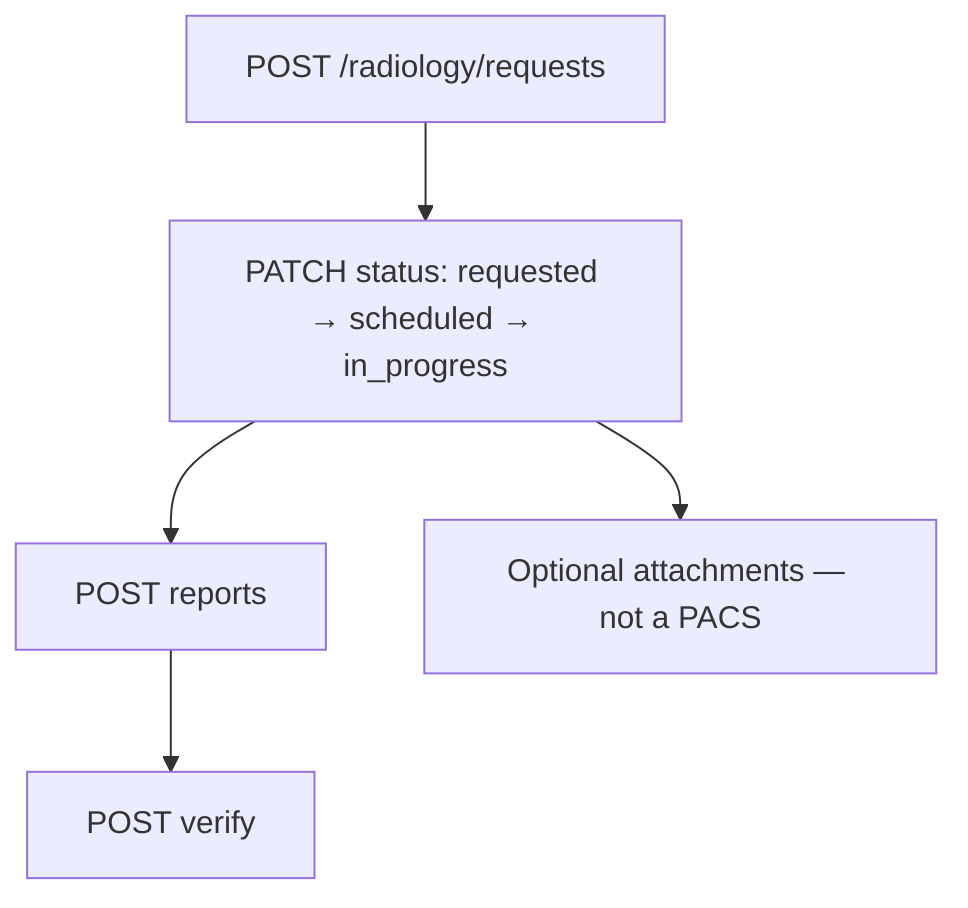

## 6. Inpatient

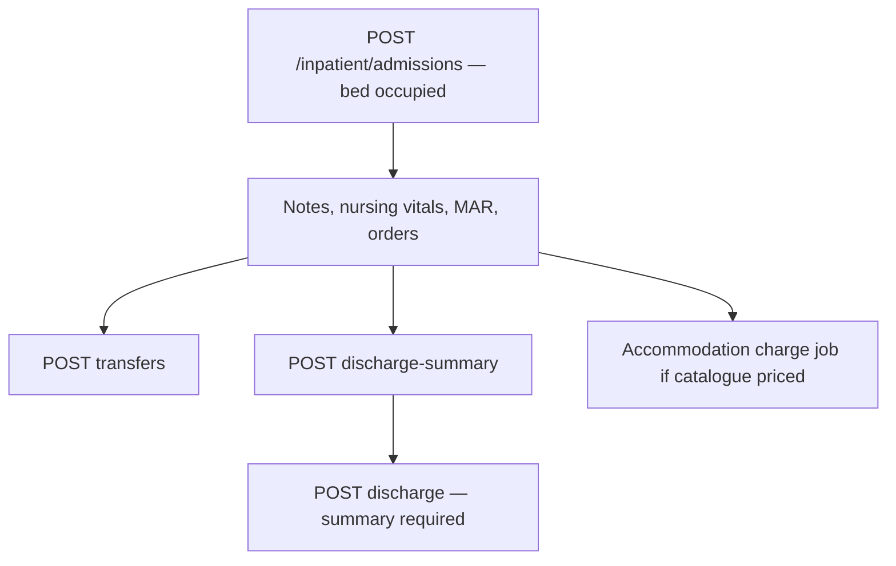

MAR does **not** decrement `inventory_batches`. Inpatient medicines still go through pharmacy dispense if prescribed.

## 7. Emergency

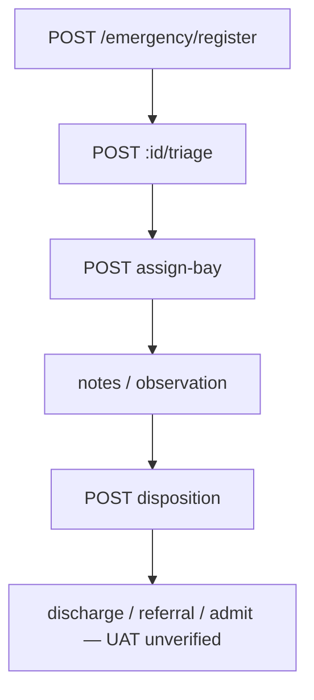

ED entities are **separate** from OPD `encounters` (`emergency_encounters`).

## 8. Charge, payment, receipt, GL

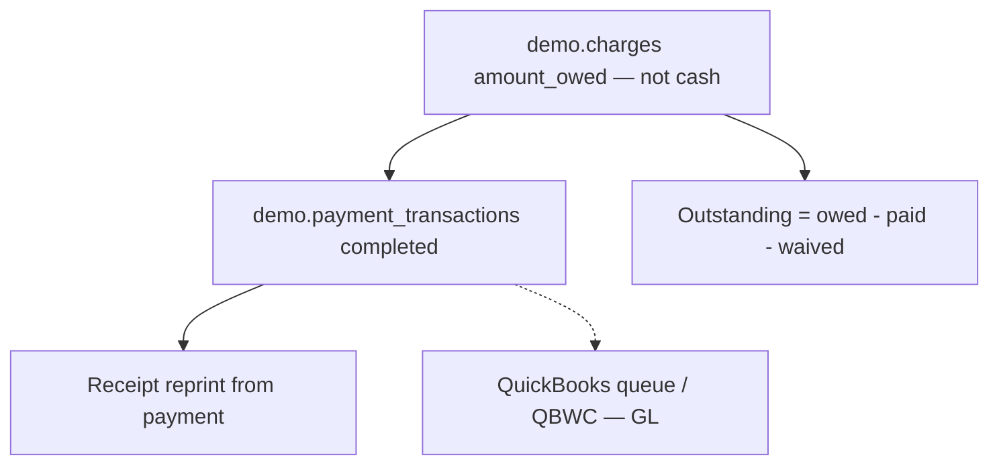

There is **no** separate invoice table in this inspection. A payment is not a charge. QB is not replaced by EMR totals.

## 9. Procurement → pharmacy availability

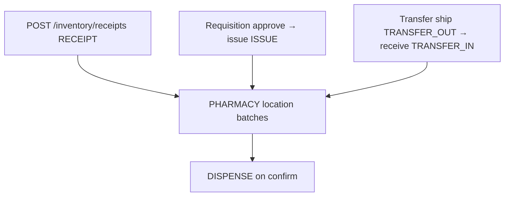

One ledger. Stock-take posts `STOCK_TAKE` variance, not counted qty as receipt.

## 10. Authentication and departmental access

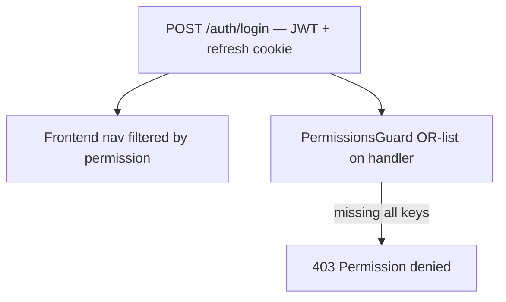

Hiding a menu is not security.

## 11. Report generation and delivery

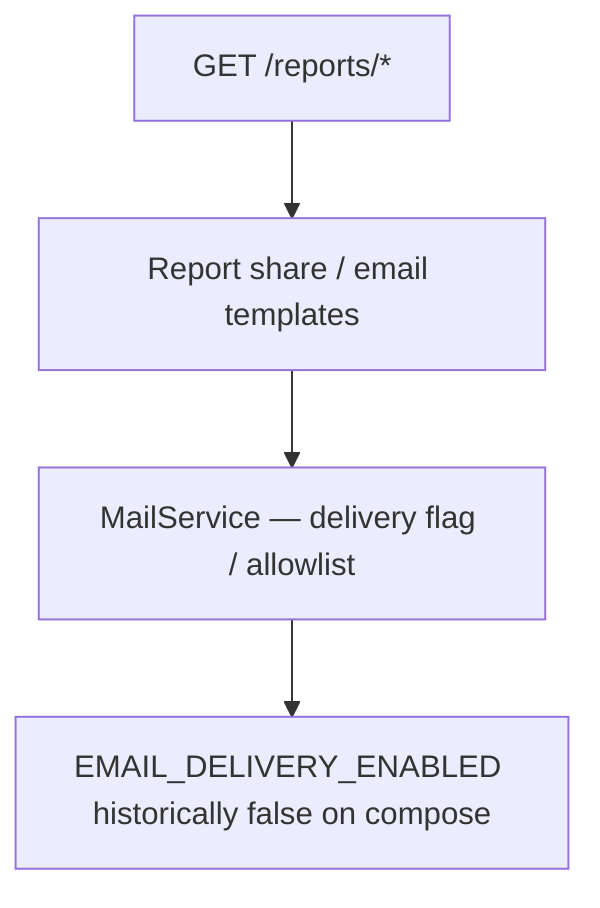

SQL backup list ≠ full system backup. UI restore **403**.

## 12. Director dashboard data flow

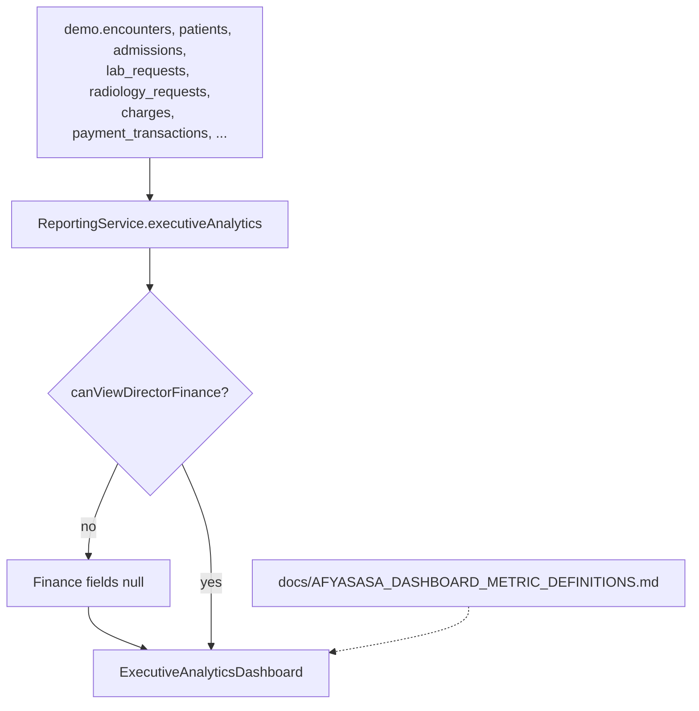

Pharmacy activity indicator: **data unavailable** (not invented from movements). Figures are **not Finance-certified**.
